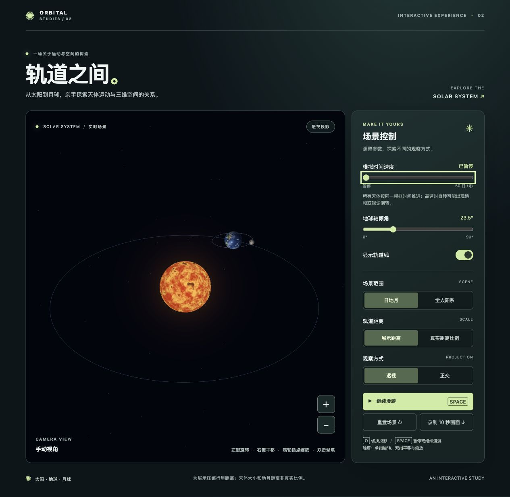
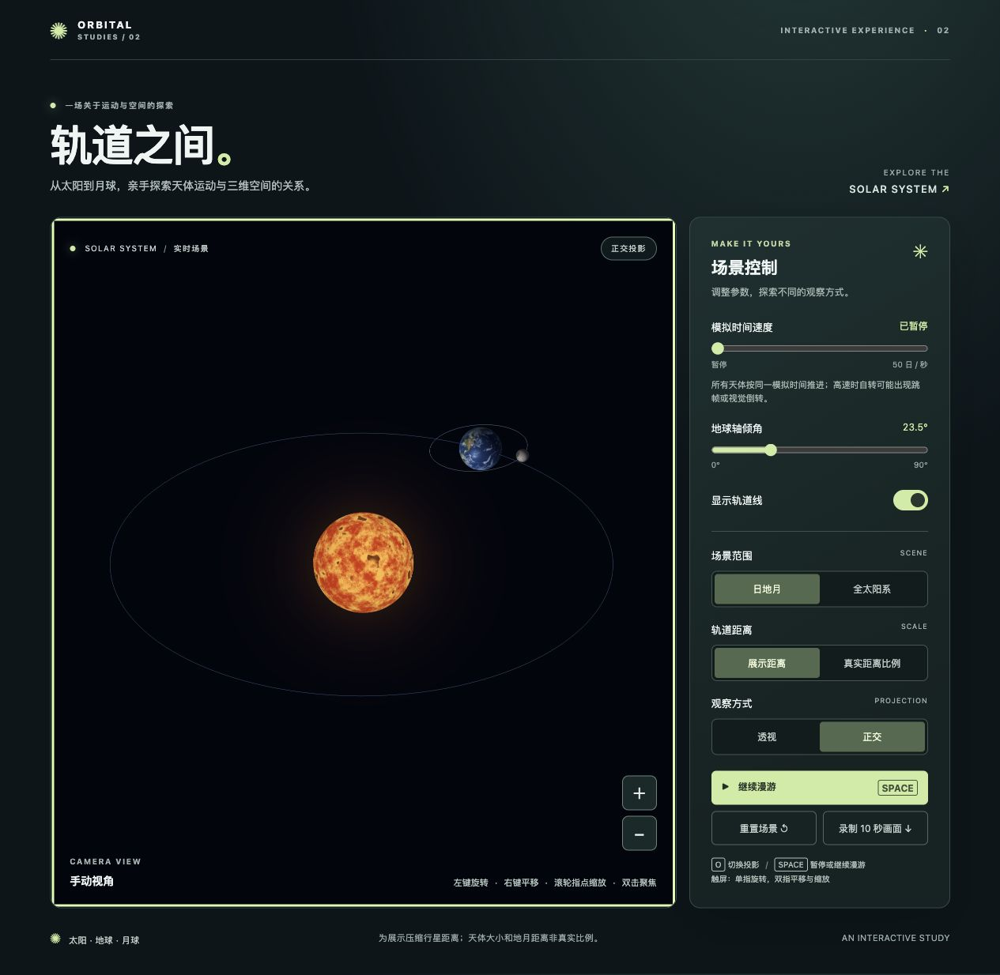

# AP2：三维层级场景——太阳系

依据课程《课程项目说明书—Assigned Projects》的 AP2 任务，展示太阳、地球和月球的层级变换，比较正交与透视投影，并提供相机漫游及交互控制。行星公转采用日心椭圆轨道和统一模拟时间；自转、公转周期采用近似真实的恒星周期。可在便于观察的展示距离与真实轨道半长轴比例之间切换。

## 运行

公网演示：[https://pigbabyye-art.github.io/computer-graphics-ap2/](https://pigbabyye-art.github.io/computer-graphics-ap2/)

需要支持 WebGL 2.0 的现代浏览器。在项目目录启动静态服务器，无需构建步骤：

```bash
python3 -m http.server 8002 --bind 127.0.0.1
```

浏览器打开 <http://127.0.0.1:8002/>。服务器终端保持运行；`Ctrl+C` 停止。本机地址仅用于运行和测试，不能作为课程要求的公网 URL。提交时请同时提供上述公网演示地址和源码 ZIP。

## 层级变换

使用列向量时，矩阵乘法中最右边的变换先作用于顶点。层级的关键是分别保留地球的轨道坐标系和地球自身的自转坐标系：

```text
世界坐标系
└── 太阳
    └── 地球轨道锚点（椭圆轨道位置的纯平移）
        ├── 地球模型（倾角旋转 × 自转 × 球体缩放）
        └── 月球模型（轨道倾角 × 椭圆位置 × 均匀自转 × 球体缩放）
```

地球轨道锚点为 `M锚 = T(x(t), y(t), z(t))`，其位置来自椭圆轨道计算；只施加平移，使地轴不会随着公转而额外转向。地球模型为 `M地球 = M锚 × Rz(倾角) × Ry(自转角) × S地球`，顶点按从右到左的顺序变换。倾角属于地球自身模型，因此它随地球位置挂到公转轨道上，而不是把整条公转轨道倾斜。月球继承地球轨道位置，不继承地球球体的缩放及自转；否则月球轨道会被错误地缩放或随地球每日自转。

## 月球椭圆轨道与手工矩阵

月球轨道采用平均偏心率 `e = 0.0549`，相对黄道面倾角约 `5.145°`；恒星公转和平均自转周期均为 `27.321661` 地球日。平近点角 `M` 随公转时间均匀变化，先解开普勒方程 `M = E − e sin E`，再得到轨道平面位置：

```text
x = a(cos E − e)；z = −a√(1 − e²) sin E
M月球 = M锚 × Rz(5.145°) × T(x, 0, z) × Ry(M) × S月球
```

矩阵使用教材 `Common/MV.js` 的基础旋转、平移、缩放及 `mult` 手工组合。地球位于月球椭圆的一个焦点，月球近地点较快、远地点较慢；默认倍率下其自转按平近点角均匀推进，而不是强行让同一个月面点时刻精确指向地球。因此，公转与自转**平均周期仍为 1:1**，中间会出现简化的经度光学天平动。可参考 [NASA 月球参数表](https://nssdc.gsfc.nasa.gov/planetary/factsheet/moonfact.html) 与 [NASA 月球天平动说明](https://science.nasa.gov/resource/moon-essentials-from-nasas-scientific-visualization-studio/)。

轨道线、模型位置和指针拾取共用同一椭圆参数。这里固定轨道面、近地点方向与示意初相（模拟第 0 日为近地点），不模拟交点和近地点进动、摄动或月球自转轴的真实倾角；也不模拟完整纬度天平动，因此不是可用于日期查询的月球星历。两种场景下的地月距离均为展示尺度，并非真实比例。

## 统一模拟时间与周期

模拟时间累计以地球日为单位；自转角和轨道的平近点角按 `360° × 模拟日数 / 恒星周期` 推进。椭圆上的实际位置再通过开普勒方程求出，因此公转角速度不是常量。整体时间速度同时影响自转和公转；独立的公转、自转倍率默认为 1×，此时保持周期比。两项倍率不同时有意改变自转与公转的相对周期，月球也不再保持同步自转。旋转周期的负号表示逆行。表中轨道周期是近似恒星公转周期，自转周期为近似恒星自转周期；数据经四舍五入，见 [NASA 行星参数表](https://nssdc.gsfc.nasa.gov/planetary/factsheet/)。

| 天体 | 绕太阳公转周期（地球日） | 自转周期（地球日） |
|---|---:|---:|
| 水星 | 88.0 | 58.65 |
| 金星 | 224.7 | −243.02 |
| 地球 | 365.256 | 0.99727 |
| 火星 | 687.0 | 1.026 |
| 木星 | 4331 | 0.4125 |
| 土星 | 10747 | 0.4458 |
| 天王星 | 30589 | −0.7167 |
| 海王星 | 59800 | 0.6708 |

太阳采用约 **25.38 地球日**的代表性近赤道恒星自转周期。太阳是等离子体，不同纬度转速不同，这里使用单一自转周期作为近似；参考 [NASA 太阳介绍](https://science.nasa.gov/learn/basics-of-space-flight/chapter1-1/) 与 [太阳事实](https://science.nasa.gov/sun/facts/)。月球绕地球约 **27.321661 日**一周，平均自转与公转周期同步，月球大致以同一面朝向地球；这与约 29.5 日的朔望月不同，见 [NASA 月球问答](https://science.nasa.gov/moon/top-moon-questions/)。

## 行星椭圆轨道与距离尺度

每颗行星使用椭圆，太阳位于一个焦点。平均近点角 `M = M₀ + 2πt/T` 随模拟时间均匀推进，再数值求解开普勒方程 `M = E − e sin E`，由偏近点角 `E` 计算轨道平面位置 `x = a(cos E − e)`、`y = a√(1−e²) sin E`，最后按轨道倾角和方向旋转到场景中。因而行星在近日点附近较快、远日点附近较慢。轨道线、行星和指针拾取共用相同的椭圆参数。

轨道偏心率、倾角、升交点和近日点方向，以及初始平近点角，参考 [NASA/JPL J2000 近似轨道元素表](https://ssd.jpl.nasa.gov/planets/approx_pos.html)；地球借用地月质心元素作为近似。元素在此固定，周期取上表近似值，不计算摄动或长期变化，因此位置不是可按日期查询的星历。地球、金星等行星的偏心率本来就很小，轨道看起来接近圆是正常现象，并没有为了视觉效果夸大。

- **展示距离**：压缩各行星间距，便于同时观察天体；各自的偏心率和周期仍按近似值计算，但行星之间的距离比不是真实比例。
- **真实距离比例**：以地球轨道半长轴为基准，八大行星的轨道半长轴使用同一比例；进入时自动切换全太阳系。内侧行星会显得很小，可以指向并滚轮放大。见[真实距离比例截图](docs/orbit-scale.png)。小行星带仅为放在火星与木星之间的示意。

两种模式下太阳和行星尺寸、地月距离均为展示而放大；行星大小、绝对距离和线速度不能据此测量。月球使用固定轨道元的简化椭圆轨道，云层非实时天气，太阳固定于中心，不模拟太阳绕质心的摆动或太阳系绕银河中心的运动。

## 观察与投影

透视投影中相同大小的物体距离相机更远时看起来更小，投影后的平行线可能汇聚；正交投影沿平行投影方向观察，远近本身不改变物体的显示大小，平行线保持平行。两种投影对照应在同一相机和天体姿态下进行，避免把姿态变化误认为投影差异。

以下为添加独立速度滑条前的本机实测截图，投影效果保持一致：拍摄前暂停相机漫游，将模拟时间速度设为暂停；保持相机与天体位置不变，仅切换投影。

| 透视投影 | 正交投影 |
|---|---|
|  |  |

[地球与月球近景截图](docs/moon-ellipse.png)展示了新的月球轨道与定点缩放；偏心率较小且视角有透视投影，截图中不易直观看出地球的焦点偏移。[各天体日照面检查图](docs/planet-review.png)由隔离验证页面逐颗渲染后拼合，不代表各行星在同一时刻的位置。

## 光影与太阳材质

太阳在原有位图纹理的基础上叠加球面三维程序噪声，形成动态颗粒、颜色变化和少量暗斑；朝向相机的透明光晕使用平滑衰减，避免硬边球壳。行星采用指向太阳的漫反射、低强度冷色环境光；地球增加独立云层、近似海面高光以及随视角和受光方向变化的大气边缘光，土星环使用程序化环带、暗缝和双面受光。行星夜面增加低强度冷色展示补光，以便辨认纹理，并非真实的环境光测量。太阳表面与光晕是艺术化示意，场景未模拟天体之间的投影遮挡，也不是物理准确的天文模拟。

## 纹理与 UV

球面顶点除了位置外还携带二维纹理坐标 `(u, v)`。纹理位图通过 `gl.texImage2D` 上传，片元着色器依据插值后的纹理坐标采样。图片的行方向与 WebGL 纹理坐标原点约定可能相反；本项目位图顶部为北极，生成球面网格时北极设为 `v=1`；上传时设置 `UNPACK_FLIP_Y_WEBGL=true`，使顶行对应较大的 V 值。若修改图片或 UV 约定，需同时核对翻转设置，避免重复翻转。可通过地球上北极与南极的位置确认方向。

## 文件与扩展

| 文件 | 作用 |
|---|---|
| `index.html`、`style.css` | 页面结构、控制面板和布局 |
| `app.js` | 面板、键盘和鼠标输入；相机漫游与逐帧状态 |
| `scene.js` | 集中配置天体参数；构造网格、上传纹理、组合变换并渲染 |
| `Common/MV.js` | 教材配套基础矩阵和向量操作 |
| `textures/` | 离线使用的天体位图纹理及素材说明 |

除太阳、地球和月球之外，场景还展示水星、金星、火星、木星、土星、天王星、海王星、土星环与小行星带，对应选做 E1。天体半径为展示而放大；展示距离模式压缩行星间距，小行星带由固定随机种子生成的点组成。

## 操作

| 控件或操作 | 功能 |
|---|---|
| 日地月／全太阳系 | 默认专注太阳、地球和月球；全太阳系显示全部行星及小行星带，切换时调整相机距离 |
| 轨道距离：展示距离／真实距离比例 | 切换压缩间距或按真实轨道半长轴比显示；真实比例自动进入全太阳系，切换日地月会恢复展示距离 |
| 模拟时间速度 | 控制整体时间：默认每真实秒 2 个模拟日，范围为暂停或 0.01～50 模拟日/秒 |
| 公转速度 / 自转速度 | 分别在 0～4× 调整相应运动；默认均为 1×，保持周期比例。倍率不同时月球同步自转也会解除 |
| 地球轴倾角 | 0°～90°，默认 23.5° |
| 显示轨道线 | 显示或隐藏轨道线 |
| 透视／正交按钮，或 `O` 键 | 切换观察投影 |
| 暂停／继续漫游按钮，或空格键 | 暂停或继续相机绕场景的漫游；天体运动由统一模拟时间控件独立控制 |
| 鼠标左键拖动 | 绕当前观察中心旋转，手动操作会暂停漫游 |
| 鼠标右键拖动，或 Shift + 左键拖动 | 平移观察中心和相机 |
| 滚轮 | 以指针位置为锚点缩放；指向天体表面可近距离观察 |
| 双击太阳、行星或月球 | 将命中位置设为旋转中心；这是固定世界坐标，不会自动跟随公转 |
| 触屏单指 / 双指 | 单指旋转；双指平移与缩放 |
| 画布上的 + / − 按钮 | 以画布中心缩放 |
| 画布获得键盘焦点后，方向键、Shift + 方向键、+ / − | 旋转、平移、缩放 |
| 重置场景 | 恢复初始参数、日地月模式、相机与透视投影，并从初始时刻重新开始 |
| 录制 10 秒画面 | 使用浏览器录制画布并下载 WebM；录制漫游时先确认相机处于漫游状态 |

系统开启减少动态效果时，相机漫游默认暂停，天体运动仍可通过模拟时间滑条控制。高速时，旋转快的行星可能因帧率采样出现跳帧、静止或视觉倒转；这是显示混叠，并非周期或方向改变。浏览器标签页隐藏时暂停推进模拟时间。录屏按钮依赖浏览器的 `captureStream`、`MediaRecorder` 和 WebM 编码支持；录制内容为画布画面，不包含侧边控件。本机录制的漫游视频见 [docs/roaming.webm](docs/roaming.webm)。

`O` 键在按钮聚焦时仍可切换投影；空格键在按钮聚焦时用于激活该按钮，不切换漫游。输入控件聚焦时不截获快捷键。暂停后再次按空格或点击继续，漫游围绕当前观察中心继续；重置或切换场景范围会恢复以太阳为中心。鼠标滚轮在画布内生效；未指向天体时以指向的观察平面为参考。

## 素材和辅助说明

地球、云层、月球和七颗其他行星使用 [Solar System Scope / INOVE 的 Solar Textures](https://www.solarsystemscope.com/textures/) 2K 位图，依据 [CC BY 4.0](https://creativecommons.org/licenses/by/4.0/) 使用；本项目将 JPEG 转为 PNG。其资料基于 NASA 图像和地形数据，颜色经过调整，未测绘区域可能含虚构填补。太阳纹理是本项目程序化生成的示意图。详见 [textures/README.md](textures/README.md)。

项目使用课程教材配套 [Common/MV.js](https://github.com/esangel/WebGL/blob/master/Common/MV.js) 进行基本矩阵运算；原仓库使用 MIT 许可，版权与许可文本见 [Common/LICENSE-MV.md](Common/LICENSE-MV.md)。项目在 Codex 辅助下编写、整合和验证；使用者应熟悉其中的变换与交互实现，并按课程规定如实说明辅助工具的使用。

## 轨道计算验证

安装有 Node.js 的环境可运行 `node tests/verify-orbits.mjs`，检查八大行星及月球的轨道方程、近远点距离与速度、周期、轨道线顶点和拾取一致性，以及月球平均同步自转。项目本身运行只需要支持 WebGL 2.0 的浏览器和静态服务器。

## 提交说明

课程要求可访问的公网 URL、源码 ZIP、README、两种投影的同场景截图，以及 10 秒漫游录屏。本机地址不是公网 URL；生成本地文件、运行本地服务器或打包本身不意味着已经发布或完成公网验收。

参数面板提供整体模拟时间、公转速度与自转速度滑条；默认两个倍率均为 1×。

## 当前版本边界

这是适合本地展示的交互原型，并非已上线的商业服务。实际对外运营前仍需验证目标浏览器和真实移动设备、确认素材及第三方代码的商业使用权、完成部署与持续维护。云层不是实时天气，部分地形为艺术化填补；天体尺寸与地月距离为演示而放大；位置不是实时星历。
